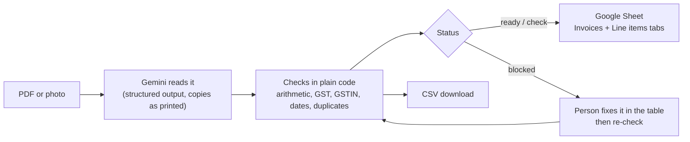

# InvoiceFlow: supplier invoices to Google Sheets, with every GST calculation checked

Upload a supplier invoice, as a PDF or a phone photo. InvoiceFlow reads it with AI, **checks the arithmetic, the GST split and the GSTIN in plain code**, shows exactly what's wrong, and sends clean data to Google Sheets: one tab for invoices, one for line items.

**Live demo:** _link coming soon_  
**Built by:** Bharti Shrivastava, AI automation engineer. [Hire me on Contra](https://contra.com/bharti_shrivastava_zu3hypce) to automate your invoice entry.

---

## The problem it solves

A small café, shop or clinic gets dozens of supplier bills a month on paper, in PDFs and as WhatsApp photos. Someone types them into a spreadsheet or Tally, which is slow and error-prone. Suppliers' own mistakes, like a wrong line total or the wrong GST type, slip through and are paid.

InvoiceFlow reads the bill, refuses to trust the numbers until they add up, and gives the owner a clean, checked sheet.

## Try it

The samples are bills from the suppliers of **Chai & Crumb Café**, a *fictional* café in Bhopal: a dairy, a vegetable vendor, a packaging company, an inter-state spice trader from Nagpur, a cleaning-supplies company and a bakery wholesaler.

| Sample | What you'll see |
|---|---|
| Narmada dairy | ✅ Ready: mixed 5% and 12% GST, CGST and SGST split correctly |
| Spice route (Nagpur) | ✅ Ready: recognised as inter-state, so IGST instead of CGST and SGST |
| CleanPro | ⛔ **Blocked**: the supplier printed ₹1,850 for 4 × ₹450. Fix it in the table, press Re-check and it turns green. |
| Indore bakery **photo** | A tilted phone photo of a bill, read by Gemini |

## Results

<!-- RESULTS:START -->
_Run `python eval/run_eval.py` with a Gemini key to fill in this table._
<!-- RESULTS:END -->

## What it checks

The AI only **reads** the document, and it is told to copy what's printed, never fix it. Every decision is made in plain Python:

| Check | Example of what it catches |
|---|---|
| Line amounts | quantity × rate doesn't equal the printed amount |
| Subtotal and total | lines don't add up to the subtotal; subtotal + GST + round-off ≠ total |
| GST split | same-state bill with IGST, or inter-state bill with CGST and SGST (from the GSTIN state codes) |
| GST rate | tax that doesn't match any GST slab or a mix of slabs |
| GSTIN | wrong length or format, unknown state code, or a **wrong check digit**, which catches most misreads and typos |
| Dates | unreadable, in the future, or more than two years old |
| Unclear text | anything the AI says it couldn't read clearly |
| Duplicates | the same invoice number from the same supplier sent twice |

Each invoice gets a status: **ready**, **check** (warnings) or **blocked** (errors). Blocked invoices can't be sent to the sheet until someone fixes them, or confirms they've looked.

## How it works



Two ways to use it:

- **Streamlit screen** (`app.py`): upload, review, correct, send. This is the live demo.
- **REST API** (`api/main.py`, **FastAPI**): `POST /invoices/parse` with a file returns the data and all checks; `POST /invoices/check` re-checks corrected data; `POST /invoices/export` sends to the sheet. Interactive docs at `/docs`. It can be protected with an API key header.

```bash
curl -F "file=@samples/05_cleanpro_with_error.pdf" http://127.0.0.1:8000/invoices/parse
```

Built with **Gemini** through **LangChain** (PDF and image input, JSON-schema structured output), **Pydantic** for the data model, **FastAPI**, **Streamlit**, and a **Google Apps Script** webhook for the sheet.

## Run it on your computer

You need Python 3.10 or newer and a free Gemini API key from [Google AI Studio](https://aistudio.google.com/apikey).

```bash
git clone <this repository's URL>
cd invoice-to-sheets
python -m venv .venv
# Windows: .venv\Scripts\activate     macOS/Linux: source .venv/bin/activate
pip install -r requirements-dev.txt
cp .env.example .env        # Windows: copy .env.example .env   then paste your key into .env
python scripts/check_setup.py
streamlit run app.py                  # the review screen
uvicorn api.main:app --reload         # or the API, docs at http://127.0.0.1:8000/docs
```

Without a key, a simple text reader handles the sample PDFs, so you can try the checks; photos and other layouts need Gemini. To send rows to a Google Sheet, follow the five steps at the top of `integrations/google_apps_script.gs`, then put the URL and token in `.env`.

```bash
pytest                    # 34 tests, no key needed
python eval/run_eval.py   # accuracy against the answer key
```

## Project structure

```
app.py                    Streamlit review screen
api/main.py               FastAPI endpoints
invoiceflow/
  readers.py              Gemini reader (PDF + images) and the no-key text reader
  validate.py             all the checks
  gstin.py                GSTIN format, state codes and check digit
  models.py               Pydantic models: Invoice, LineItem, Check, ParseResult
  export.py               Google Sheet rows, CSV, duplicate protection
  pipeline.py             read -> check -> export
samples/                  6 fictional invoices + answer_key.json
scripts/                  setup check, sample generator
integrations/             Google Apps Script for the sheet
eval/run_eval.py          accuracy against the answer key
```

## Limitations

- The evaluation uses 6 sample invoices; real bills (handwritten, faded, multi-page) will be harder. Low-confidence fields are flagged so a person checks them.
- The GSTIN check digit proves a number is well-formed, not that it is registered. A live setup could also query the GST portal.
- Duplicate protection is kept in a local file; a shared database would be used in production.
- Exporting to Tally or Zoho Books instead of Google Sheets is a small change in `export.py`.

## Want this for your business?

I build document automations like this: invoices, purchase orders, delivery notes and KYC forms, into Google Sheets, Excel, Tally or your own system, with checks that catch mistakes before they cost you. [Message me on Contra](https://contra.com/bharti_shrivastava_zu3hypce).

---

MIT licensed. Chai & Crumb Café, its suppliers, GSTINs and invoices are fictional and exist only for this demo.
